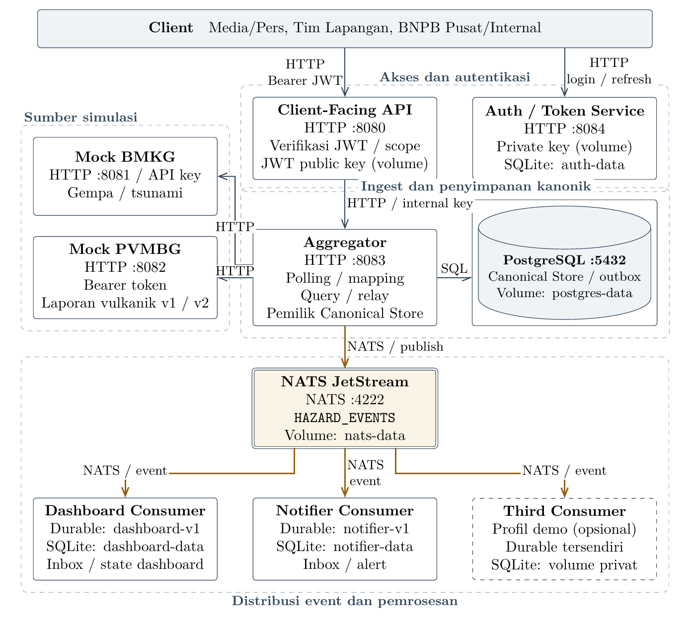

<a id="readme-top"></a>

<div align="center">
  <h3 align="center">IF4031/AAT - Koordinasi Kebencanaan M1</h3>
  <p align="center">
    Tugas Besar IF4031 Arsitektur Aplikasi Terdistribusi<br/>
    Milestone 1 · DikejarDeadline
  </p>
</div>

<div align="center">
  <br/>
  
  
  
  
</div>

---

<details>
  <summary>Daftar Isi</summary>
  <ol>
    <li><a href="#latar-belakang">Latar belakang</a></li>
    <li><a href="#arsitektur">Arsitektur</a></li>
    <li><a href="#menjalankan-aplikasi">Menjalankan aplikasi</a></li>
    <li><a href="#variabel-konfigurasi">Variabel konfigurasi</a></li>
    <li><a href="#mengubah-konfigurasi">Mengubah konfigurasi</a></li>
    <li><a href="#pengujian-per-problem">Pengujian per problem</a>
      <ul>
        <li><a href="#problem-1">P1: Arsitektur &amp; Interoperabilitas Data</a></li>
        <li><a href="#problem-2">P2: Concurrency, Availability, &amp; Graceful Degradation</a></li>
        <li><a href="#problem-3">P3: Service-to-Service Authentication &amp; Trust</a></li>
        <li><a href="#problem-4">P4: Arsitektur Microservice &amp; Flexible Storage</a></li>
        <li><a href="#problem-5">P5: Fan-out Event Distribution/Pub-Sub</a></li>
      </ul>
    </li>
    <li><a href="#log-dan-menghentikan-sistem">Log dan menghentikan sistem</a></li>
    <li><a href="#lokasi-kode-dan-laporan">Lokasi kode dan laporan</a></li>
  </ol>
</details>

## Latar belakang

Repositori ini berisi implementasi Milestone 1 untuk tugas besar IF4031 Arsitektur Aplikasi Terdistribusi. Tugas ini mengangkat kebutuhan BNPB untuk menyatukan informasi gempa dan tsunami dari BMKG serta aktivitas gunung api dari PVMBG, agar dapat digunakan oleh Media, Tim Lapangan, dan BNPB internal.

Pada implementasi ini, kedua instansi disimulasikan melalui mock dengan data sintetis. Sistem menyatukan data dalam format `HazardEvent` dan menyediakan akses melalui API serta distribusi event, dengan pengujian perubahan skema, ketahanan layanan, dan hak akses client.

Panduan berikut menjalankan sistem dari clone baru dan mengulang skenario P1–P5 dalam [laporan M1](docs/report/IF4031_M1_DikejarDeadline.pdf). ID dan waktu pada data sintetis berubah setiap sesi; hasil latency dan throughput bergantung pada mesin pengujian.

<div align="right"><a href="#readme-top">↖ Kembali ke atas</a></div>

---

## Arsitektur



Panah hitam menunjukkan arah request HTTP/SQL, sedangkan panah berwarna menunjukkan distribusi event melalui NATS. Third Consumer bersifat opsional dan digunakan untuk menguji penambahan consumer pada P5.

<div align="right"><a href="#readme-top">↖ Kembali ke atas</a></div>

---

## Menjalankan aplikasi

Gunakan Linux atau WSL2 dengan Bash, Git, Docker yang sudah aktif, Docker Compose v2, Python 3, OpenSSL, curl, jq, dan `ss` (paket `iproute2`). Go 1.23 atau lebih baru diperlukan untuk pengujian kode dan JSON Schema. Service dibangun melalui Docker; Python tidak memerlukan paket tambahan.

### Konfigurasi awal

```bash
git clone https://github.com/ryonlunar/tugas-besar-AAT.git
cd tugas-besar-AAT
test -e .env || cp .env.example .env
```

Buat secret berbeda untuk setiap sumber, service internal, dan client. Command berikut hanya mengisi nilai yang masih kosong:

```bash
for name in BMKG_API_KEY PVMBG_TOKEN AGGREGATOR_API_KEY CONSUMER_DEMO_KEY \
  POSTGRES_PASSWORD NATS_TOKEN MEDIA_CLIENT_SECRET FIELD_TEAM_CLIENT_SECRET \
  BNPB_INTERNAL_CLIENT_SECRET; do
  value=$(openssl rand -hex 32)
  sed -i "s/^${name}=$/${name}=${value}/" .env
done
```

Buat pasangan kunci RSA untuk signing di Auth dan verifikasi di Client API, lalu muat ke volume Docker:

```bash
set -a
. ./.env
set +a
mkdir -p .secrets
chmod 700 .secrets
if [ ! -e .secrets/jwt-private.pem ] && [ ! -e .secrets/jwt-public.pem ]; then
  (umask 077; openssl genpkey -algorithm RSA -pkeyopt rsa_keygen_bits:2048 -out .secrets/jwt-private.pem)
  openssl pkey -in .secrets/jwt-private.pem -pubout -out .secrets/jwt-public.pem
fi
python3 scripts/setup-jwt-keys.py
docker compose up --build --detach --wait --wait-timeout 180
docker compose ps
curl -fsS "http://127.0.0.1:${API_HTTP_PORT:-8080}/ready"
```

Sembilan service utama harus berstatus healthy. Endpoint `/ready` pada Client API harus mengembalikan HTTP 200. PostgreSQL, NATS, dan consumer hanya tersedia di jaringan container.

| Service yang dapat diakses dari host | Alamat default |
|---|---|
| Client API | `http://127.0.0.1:8080` |
| BMKG mock | `http://127.0.0.1:8081` |
| PVMBG mock | `http://127.0.0.1:8082` |
| Aggregator | `http://127.0.0.1:8083` |
| Auth | `http://127.0.0.1:8084` |

### Environment untuk pengujian

Jalankan blok ini sekali. Lanjutkan semua command pengujian di terminal yang sama agar environment tetap tersedia:

```bash
set -o pipefail
set -a
. ./.env
set +a
export API_URL="http://127.0.0.1:${API_HTTP_PORT:-8080}"
export AUTH_URL="http://127.0.0.1:${AUTH_HTTP_PORT:-8084}"
export BMKG_URL="http://127.0.0.1:${BMKG_MOCK_HTTP_PORT:-8081}"
export PVMBG_URL="http://127.0.0.1:${PVMBG_MOCK_HTTP_PORT:-8082}"
export AGGREGATOR_URL="http://127.0.0.1:${AGGREGATOR_HTTP_PORT:-8083}"
EVIDENCE_DIR="docs/evidence/private/$(date +%Y%m%d-%H%M%S)"
mkdir -p "$EVIDENCE_DIR"
```

Hasil baru disimpan di `$EVIDENCE_DIR`, terpisah dari bukti pengukuran yang sudah ada di laporan. Jalankan skenario secara berurutan; beberapa pengujian mengubah kontrol mock atau menghentikan service sementara.

Setiap problem menyediakan trial otomatis dan langkah manual mengikuti bukti laporan. Jalankan langkah manual satu per satu, tanpa menjalankan trial bersamaan. Command memakai port dari `.env`; screenshot laporan menggunakan port 8280–8284.

<a id="login-manual"></a>

<details>
<summary>Login Tim Lapangan untuk command API manual</summary>

Jalankan login ini sebelum pemeriksaan API pada P2, P4, atau log. Ulangi jika token sudah expired; access token berlaku 60 detik. File sesi disimpan di `.secrets/` dan tidak masuk Git.

```bash
umask 077
mkdir -p .secrets/demo-session
jq -n '{client_id:"field-team", client_secret:env.FIELD_TEAM_CLIENT_SECRET}' \
  | curl -fsS -H 'Content-Type: application/json' --data-binary @- \
      "$AUTH_URL/v1/auth/login" -o .secrets/demo-session/field-team.json
jq '{token_type, expires_in, scope}' .secrets/demo-session/field-team.json
FIELD_ACCESS_TOKEN=$(jq -r .access_token .secrets/demo-session/field-team.json)
```

</details>

<div align="right"><a href="#readme-top">↖ Kembali ke atas</a></div>

---

## Variabel konfigurasi

[.env.example](.env.example) memuat seluruh nilai default. Pertahankan profil berikut untuk mengulang pengujian laporan: seed 20 record, event baru setiap 10 detik, polling 5 detik, PVMBG skema 1 tanpa outage, dan access token 60 detik. P2 mengubah delay PVMBG menjadi 3000 ms selama load test.

| Kelompok | Variabel | Fungsi |
|---|---|---|
| Project | `COMPOSE_PROJECT_NAME` | Nama container, network, dan volume; default `aat` |
| Port HTTP | `BMKG_MOCK_HTTP_PORT`, `PVMBG_MOCK_HTTP_PORT`, `API_HTTP_PORT`, `AGGREGATOR_HTTP_PORT`, `AUTH_HTTP_PORT`, `DASHBOARD_HTTP_PORT`, `NOTIFIER_HTTP_PORT` | Listener service; default 8081, 8082, 8080, 8083, 8084, 8085, 8086 |
| Alamat HTTP internal | `BMKG_BASE_URL`, `PVMBG_BASE_URL`, `AGGREGATOR_BASE_URL` | Tujuan polling dan pembacaan internal |
| Credential sumber/internal | `BMKG_API_KEY`, `PVMBG_TOKEN`, `AGGREGATOR_API_KEY`, `CONSUMER_DEMO_KEY` | Autentikasi mock, API internal, dan endpoint demo consumer |
| Credential client | `MEDIA_CLIENT_SECRET`, `FIELD_TEAM_CLIENT_SECRET`, `BNPB_INTERNAL_CLIENT_SECRET` | Login `media`, `field-team`, dan `bnpb-internal` |
| PostgreSQL | `POSTGRES_HOST`, `POSTGRES_PORT`, `POSTGRES_DB`, `POSTGRES_USER`, `POSTGRES_PASSWORD`, `POSTGRES_SSLMODE` | Koneksi Canonical Store |
| Mock | `MOCK_SEED_COUNT`, `MOCK_EVENT_INTERVAL`, `BMKG_DELAY_MS`, `PVMBG_DELAY_MIN_MS`, `PVMBG_DELAY_MAX_MS`, `PVMBG_SCHEMA_VERSION`, `PVMBG_OUTAGE_ENABLED` | Seed, interval event, delay, skema awal, dan outage awal |
| Polling | `SOURCE_POLL_INTERVAL`, `BMKG_REQUEST_TIMEOUT`, `PVMBG_REQUEST_TIMEOUT`, `SOURCE_RESPONSE_MAX_BYTES`, `SOURCE_STALE_AFTER` | Interval, deadline, ukuran snapshot, dan ambang stale |
| Token | `ACCESS_TOKEN_TTL`, `REFRESH_TOKEN_TTL`, `JWT_ISSUER`, `JWT_AUDIENCE`, `JWT_PRIVATE_KEY_FILE`, `JWT_PUBLIC_KEY_FILE` | Masa berlaku, claim, dan lokasi kunci JWT |
| State lokal | `AUTH_STATE_PATH`, `DASHBOARD_STATE_PATH`, `NOTIFIER_STATE_PATH` | Lokasi SQLite privat masing-masing service |
| Broker | `NATS_URL`, `NATS_TOKEN`, `NATS_STREAM_NAME`, `NATS_DASHBOARD_DURABLE`, `NATS_NOTIFIER_DURABLE` | Koneksi NATS, stream, dan durable independen |

<details>
<summary>Konfigurasi kapasitas, timeout, dan retry</summary>

| Kelompok | Variabel | Fungsi |
|---|---|---|
| Pool PostgreSQL | `DB_READ_MAX_CONNS`, `DB_BMKG_WRITE_MAX_CONNS`, `DB_PVMBG_WRITE_MAX_CONNS`, `DB_RELAY_MAX_CONNS`, `DB_READ_TIMEOUT`, `DB_WRITE_TIMEOUT` | Memisahkan kapasitas baca, ingest, dan relay serta membatasi durasi operasi |
| API dan HTTP | `API_MAX_INFLIGHT`, `AGGREGATOR_MAX_INFLIGHT`, `AGGREGATOR_REQUEST_TIMEOUT`, `HTTP_READ_HEADER_TIMEOUT`, `HTTP_IDLE_TIMEOUT`, `HTTP_WRITE_TIMEOUT` | Admission limit dan timeout HTTP |
| Auth | `AUTH_MAX_INFLIGHT`, `AUTH_BODY_MAX_BYTES`, `AUTH_READ_TIMEOUT` | Batas request bersamaan, ukuran body, dan waktu baca |
| Retention JetStream | `NATS_MAX_AGE`, `NATS_MAX_BYTES`, `NATS_MAX_MSGS`, `NATS_MAX_MSG_SIZE`, `NATS_DUPLICATE_WINDOW` | Batas penyimpanan dan window dedup; default 24 jam, 256 MiB, 100.000 pesan, 64 KiB, dan 2 menit |
| Publish dan consumer | `NATS_PUBLISH_TIMEOUT`, `NATS_ACK_WAIT`, `NATS_MAX_ACK_PENDING`, `NATS_MAX_DELIVER`, `NATS_FETCH_BATCH`, `NATS_FETCH_EXPIRES`, `CONSUMER_NAK_DELAY` | Deadline publish, ACK, batch pull, dan redelivery |
| Outbox | `OUTBOX_POLL_INTERVAL`, `OUTBOX_BATCH_SIZE`, `OUTBOX_MAX_PENDING`, `OUTBOX_RETRY_MIN`, `OUTBOX_RETRY_MAX` | Interval relay, ukuran batch, kapasitas antrean, dan backoff retry |

</details>

Jika port service berubah, sesuaikan base URL internalnya. Compose menetapkan alamat PostgreSQL/NATS serta path kunci dan state; nilai variabel tersebut di `.env.example` juga menjadi acuan saat menjalankan binary langsung.

### Mengubah konfigurasi

Ubah `.env`, muat ulang environment terminal, lalu buat ulang container yang memakai nilai tersebut. `restart` hanya menjalankan ulang container dengan konfigurasi lama; `up --force-recreate --no-deps` menerapkan konfigurasi baru tanpa menjalankan ulang dependency.

Contoh mempercepat polling menjadi 2 detik, dengan hanya membuat ulang Aggregator:

```bash
sed -i 's/^SOURCE_POLL_INTERVAL=.*/SOURCE_POLL_INTERVAL=2s/' .env
set -a
. ./.env
set +a
docker compose up --detach --no-deps --force-recreate --wait aggregator
docker inspect "$(docker compose ps -q aggregator)" \
  | jq -r '.[0].Config.Env[] | select(startswith("SOURCE_POLL_INTERVAL="))'
```

Output harus menunjukkan `SOURCE_POLL_INTERVAL=2s`. Muat ulang environment setiap selesai mengedit `.env`, karena Compose mendahulukan nilai yang sudah diekspor di terminal daripada nilai dalam file.

| Perubahan | Container yang perlu dibuat ulang |
|---|---|
| Interval polling, timeout sumber | `aggregator` |
| Interval event atau jumlah seed | `bmkg-mock pvmbg-mock`; katalog mock dimulai ulang |
| TTL token atau secret client | `auth`; TTL berlaku untuk token yang baru diterbitkan |
| Port BMKG/PVMBG dan base URL terkait | Mock terkait dan `aggregator` |
| Port Aggregator dan `AGGREGATOR_BASE_URL` | `aggregator client-api` |
| Port Client API atau Auth | `client-api` atau `auth` |
| Credential sumber | Mock terkait dan `aggregator` |
| `AGGREGATOR_API_KEY` | `aggregator client-api` |
| `JWT_ISSUER`, `JWT_AUDIENCE` | `auth client-api` |
| `NATS_TOKEN` | `nats aggregator` dan seluruh consumer yang aktif |

Perubahan port harus mencakup listener dan alamat pemanggilnya. Misalnya, `BMKG_MOCK_HTTP_PORT=8091` perlu dipasangkan dengan `BMKG_BASE_URL=http://bmkg-mock:8091`. Untuk mengganti port Client API menjadi 8088:

```bash
sed -i 's/^API_HTTP_PORT=.*/API_HTTP_PORT=8088/' .env
set -a
. ./.env
set +a
docker compose up --detach --no-deps --force-recreate --wait client-api
export API_URL="http://127.0.0.1:$API_HTTP_PORT"
curl -fsS "$API_URL/ready"
```

Sesuaikan juga `AUTH_URL`, `BMKG_URL`, `PVMBG_URL`, atau `AGGREGATOR_URL` bila portnya berubah. Sebelum mengulang pengujian laporan, kembalikan polling ke 5 detik dan port API ke 8080, lalu terapkan kembali:

```bash
sed -i 's/^SOURCE_POLL_INTERVAL=.*/SOURCE_POLL_INTERVAL=5s/; s/^API_HTTP_PORT=.*/API_HTTP_PORT=8080/' .env
set -a
. ./.env
set +a
docker compose up --detach --no-deps --force-recreate --wait aggregator client-api
export API_URL="http://127.0.0.1:$API_HTTP_PORT"
```

Konfigurasi yang tersimpan sebagai state mempunyai aturan berbeda: mengganti environment PostgreSQL tidak mengubah user/password pada volume yang sudah diinisialisasi. Aggregator juga memvalidasi konfigurasi stream JetStream yang sudah ada, bukan memperbarui retention-nya secara otomatis.

Skema, outage, dan delay PVMBG untuk P1/P2 diubah melalui endpoint admin di bawah, tanpa membuat ulang container.

<div align="right"><a href="#readme-top">↖ Kembali ke atas</a></div>

---

## Pengujian per problem

<a id="problem-1"></a>

### P1: Arsitektur & Interoperabilitas Data

Uji pemetaan dan kontrak data, lalu jalankan trial pada sistem aktif:

```bash
go test ./contracts ./services/aggregator/internal/mapper/...
python3 scripts/verify-integration.py --scenario smoke --output "$EVIDENCE_DIR/smoke.json" \
  | tee "$EVIDENCE_DIR/smoke.log"
jq '{passed, results}' "$EVIDENCE_DIR/smoke.json"
```

Trial harus menghasilkan `passed: true`: pemetaan sesuai sumber dan revisi v1/v2 terbaca tanpa migration atau restart. `smoke` juga memeriksa outage P2 dan hak akses P3, lalu memulihkan skema awal.

<details>
<summary>Manual: pemetaan data dan perubahan skema</summary>

**1. Bandingkan gempa sumber dan hasil kanonik.** Source reference, region, koordinat, magnitude, dan waktu harus sesuai; severity mengikuti batas magnitude pada laporan.

```bash
curl -fsS -H "X-BMKG-Key: $BMKG_API_KEY" "$BMKG_URL/seismic-events" \
  > "$EVIDENCE_DIR/bmkg-source.json"
BMKG_REF=$(jq -r '[.[] | select(.potential_tsunami == false)][-1].event_id' \
  "$EVIDENCE_DIR/bmkg-source.json")
jq --arg id "$BMKG_REF" '.[] | select(.event_id == $id)' "$EVIDENCE_DIR/bmkg-source.json"
sleep 10
curl -fsS -H "X-Internal-Key: $AGGREGATOR_API_KEY" \
  "$AGGREGATOR_URL/internal/v1/hazards?source=BMKG&view=full&limit=100" \
  | jq -e --arg id "$BMKG_REF" '.data[] | select(.source_ref_id == $id)'
```

**2. Ambil record PVMBG baru pada skema v1** agar audit revisi 1/2 dapat diulang. Jeda menunggu event baru dan polling dengan interval default.

```bash
curl -fsS -X POST "$PVMBG_URL/admin/schema-version" \
  -H "Authorization: Bearer $PVMBG_TOKEN" \
  -H 'Content-Type: application/json' -d '{"version":1}' | jq .
LAST_PVMBG_REF=$(curl -fsS -H "Authorization: Bearer $PVMBG_TOKEN" \
  "$PVMBG_URL/volcanic-reports" | jq -r '.[-1].report_id')
sleep 12
curl -fsS -H "Authorization: Bearer $PVMBG_TOKEN" "$PVMBG_URL/volcanic-reports" \
  > "$EVIDENCE_DIR/pvmbg-source.json"
PVMBG_REF=$(jq -r '.[-1].report_id' "$EVIDENCE_DIR/pvmbg-source.json")
test "$PVMBG_REF" != "$LAST_PVMBG_REF"
jq --arg id "$PVMBG_REF" '.[] | select(.report_id == $id)' "$EVIDENCE_DIR/pvmbg-source.json"
sleep 10
curl -fsS -H "X-Internal-Key: $AGGREGATOR_API_KEY" \
  "$AGGREGATOR_URL/internal/v1/hazards?source=PVMBG&view=full&limit=100" \
  | jq -e --arg id "$PVMBG_REF" '.data[] | select(.source_ref_id == $id)'
```

Ulangi langkah 2 jika `test` gagal atau hasil kanonik belum tersedia. Severity mengikuti alert level, lokasi memakai fixture gunung, dan `attributes` belum memuat `confidence_level`.

**3. Catat container dan migration, lalu aktifkan skema v2 tanpa restart.**

```bash
docker inspect $(docker compose ps -q) \
  | jq -S 'sort_by(.Name) | map({name:.Name, id:.Id,
      started_at:.State.StartedAt, restarts:.RestartCount})' \
  > "$EVIDENCE_DIR/schema-before.json"
docker compose exec -T aggregator /aggregator store-audit \
  | jq '[.migrations[].version]' > "$EVIDENCE_DIR/migrations-before.json"
curl -fsS -X POST "$PVMBG_URL/admin/schema-version" \
  -H "Authorization: Bearer $PVMBG_TOKEN" \
  -H 'Content-Type: application/json' -d '{"version":2}' | jq .
sleep 10
```

**4. Audit revisi 1/2.** Confidence hanya muncul pada revisi 2; ID hazard tetap sama.

```bash
docker compose exec -T aggregator /aggregator history-audit \
  --source PVMBG --source-ref-id "$PVMBG_REF" --revisions 1,2 \
  | tee "$EVIDENCE_DIR/schema-history.json" \
  | jq '{hazard_id, source_ref_id,
      versions:[.versions[] | {revision, attributes:.data.attributes}],
      migrations:[.migrations[].version]}'
jq '[.migrations[].version]' "$EVIDENCE_DIR/schema-history.json" \
  > "$EVIDENCE_DIR/migrations-after.json"
diff -s "$EVIDENCE_DIR/migrations-before.json" "$EVIDENCE_DIR/migrations-after.json"
docker inspect $(docker compose ps -q) \
  | jq -S 'sort_by(.Name) | map({name:.Name, id:.Id,
      started_at:.State.StartedAt, restarts:.RestartCount})' \
  > "$EVIDENCE_DIR/schema-after.json"
diff -s "$EVIDENCE_DIR/schema-before.json" "$EVIDENCE_DIR/schema-after.json"
```

Kedua `diff` harus menunjukkan file identik. Kembalikan skema ke v1:

```bash
curl -fsS -X POST "$PVMBG_URL/admin/schema-version" \
  -H "Authorization: Bearer $PVMBG_TOKEN" \
  -H 'Content-Type: application/json' -d '{"version":1}' | jq .
```

Validasi JSON Schema untuk delapan record pada bukti laporan:

```bash
go run -mod=readonly docs/report/evidence/validate-records.go
```

</details>

<a id="problem-2"></a>

### P2: Concurrency, Availability, & Graceful Degradation

Pada trial `smoke`, outage PVMBG harus menghasilkan data terakhir berstatus `stale` dengan HTTP 200. BMKG tetap dilayani, dan PVMBG kembali `fresh` setelah pulih tanpa restart.

<details>
<summary>Memicu dan memulihkan outage secara manual</summary>

Jalankan [login Tim Lapangan](#login-manual), lalu aktifkan outage:

```bash
curl -fsS -X POST "$PVMBG_URL/admin/outage" \
  -H "Authorization: Bearer $PVMBG_TOKEN" \
  -H 'Content-Type: application/json' -d '{"enabled":true}' | jq .
curl -sS -o /dev/null -w 'PVMBG saat outage: %{http_code}\n' \
  -H "Authorization: Bearer $PVMBG_TOKEN" "$PVMBG_URL/volcanic-reports"
sleep 10
```

Request langsung ke sumber harus mendapat 503; API tetap menyajikan data PVMBG `stale` dan BMKG `fresh`:

```bash
curl -fsS -H "Authorization: Bearer $FIELD_ACCESS_TOKEN" \
  "$API_URL/v1/hazards?source=PVMBG&view=full&limit=5" \
  | jq '{records:(.data | length), source:.meta.sources.PVMBG}'
curl -fsS -H "Authorization: Bearer $FIELD_ACCESS_TOKEN" \
  "$API_URL/v1/hazards?source=BMKG&view=full&limit=1" | jq '.meta.sources.BMKG'
```

Pulihkan PVMBG: status harus kembali `fresh` dan `stale_since` null.

```bash
curl -fsS -X POST "$PVMBG_URL/admin/outage" \
  -H "Authorization: Bearer $PVMBG_TOKEN" \
  -H 'Content-Type: application/json' -d '{"enabled":false}' | jq .
sleep 10
curl -fsS -H "Authorization: Bearer $FIELD_ACCESS_TOKEN" \
  "$API_URL/v1/hazards?source=PVMBG&view=full&limit=1" | jq '.meta.sources.PVMBG'
```

</details>

Atur delay PVMBG 3 detik dan ukur respons sumber:

```bash
curl -fsS -X POST "$PVMBG_URL/admin/delay" \
  -H "Authorization: Bearer $PVMBG_TOKEN" \
  -H 'Content-Type: application/json' -d '{"min_ms":3000,"max_ms":3000}'
curl -fsS -o /dev/null -w 'HTTP %{http_code}, durasi %{time_total} detik\n' \
  -H "Authorization: Bearer $PVMBG_TOKEN" "$PVMBG_URL/volcanic-reports"
sleep 5
```

Respons harus 200 dalam sekitar 3 detik. Jalankan 30 worker per sumber selama 90 detik, dengan sampel TCP setiap detik:

```bash
python3 scripts/load/capture-tcp-connections.py --api-url "$API_URL" \
  --seconds 110 --interval 1 --output "$EVIDENCE_DIR/tcp.json" &
tcp_pid=$!
python3 scripts/load/hazards-monotonic.py --seconds 90 --vus-per-source 30 \
  --output "$EVIDENCE_DIR/load.json" | tee "$EVIDENCE_DIR/load.log"
load_exit=$?
wait "$tcp_pid"
tcp_exit=$?
test "$load_exit" -eq 0 && test "$tcp_exit" -eq 0
jq '{passed, profile, sources, hazard_successes_per_second, hazard_unexpected_error_percent, auth}' \
  "$EVIDENCE_DIR/load.json"
```

Hasil harus `passed: true`, p95 BMKG <300 ms, dan error selain 429 <1%. Output mencakup p50/p95/p99, throughput, dan jumlah 429.

Hitung durasi sampel berurutan dengan sedikitnya 50 koneksi TCP:

```bash
jq '.sampling_interval_seconds as $interval
  | reduce .samples[] as $s
      ({start: null, previous: null, longest: 0, peak: 0};
       .peak = ([.peak, $s.established_connections_to_api] | max)
       | if $s.established_connections_to_api >= 50 then
           if .start == null or ($s.elapsed_seconds - .previous > 2.5 * $interval)
           then .start = $s.elapsed_seconds else . end
           | .longest = ([.longest, ($s.elapsed_seconds - .start)] | max)
         else .start = null end
       | .previous = $s.elapsed_seconds)
  | {peak_connections: .peak, seconds_at_least_50: .longest, passed: (.longest >= 60)}' \
  "$EVIDENCE_DIR/tcp.json" | tee "$EVIDENCE_DIR/tcp-assessment.json"
```

Hasil harus `passed: true` dengan `seconds_at_least_50` ≥60 detik; jumlah worker bukan bukti jumlah koneksi.

Kembalikan delay setelah pengujian:

```bash
curl -fsS -X POST "$PVMBG_URL/admin/delay" \
  -H "Authorization: Bearer $PVMBG_TOKEN" \
  -H 'Content-Type: application/json' -d '{"min_ms":500,"max_ms":3000}'
```

<a id="problem-3"></a>

### P3: Service-to-Service Authentication & Trust

Bandingkan credential: dua request pertama harus 200, dua berikutnya 401/403.

```bash
curl -sS -o /dev/null -w 'BMKG dengan key BMKG: %{http_code}\n' \
  -H "X-BMKG-Key: $BMKG_API_KEY" "$BMKG_URL/seismic-events"
curl -sS -o /dev/null -w 'PVMBG dengan token PVMBG: %{http_code}\n' \
  -H "Authorization: Bearer $PVMBG_TOKEN" "$PVMBG_URL/volcanic-reports"
curl -sS -o /dev/null -w 'BMKG dengan key PVMBG: %{http_code}\n' \
  -H "X-BMKG-Key: $PVMBG_TOKEN" "$BMKG_URL/seismic-events"
curl -sS -o /dev/null -w 'PVMBG dengan token BMKG: %{http_code}\n' \
  -H "Authorization: Bearer $BMKG_API_KEY" "$PVMBG_URL/volcanic-reports"
```

Trial `smoke` memeriksa ringkasan Media dan full view Tim Lapangan/BNPB internal. Uji juga penolakan raw, expiry, dan refresh:

```bash
go test ./services/client-api/... ./services/auth/...
python3 scripts/verify-integration.py --scenario tokens --output "$EVIDENCE_DIR/tokens.json" \
  | tee "$EVIDENCE_DIR/tokens.log"
jq '{passed, results}' "$EVIDENCE_DIR/tokens.json"
```

Trial harus lulus: JWT valid bekerja saat Auth mati, token expired ditolak, refresh menghasilkan token baru, dan replay refresh membatalkan keluarga sesi. Auth dijalankan kembali setelah trial.

Secret berada di `.env` dan `.secrets/` yang diabaikan Git; nilai secret pada `.env.example` kosong.

<details>
<summary>Manual: hak akses Media, expiry, dan refresh</summary>

**1. Login Media dan periksa field ringkasan.**

```bash
umask 077
mkdir -p .secrets/demo-session
jq -n '{client_id:"media", client_secret:env.MEDIA_CLIENT_SECRET}' \
  | curl -fsS -H 'Content-Type: application/json' --data-binary @- \
      "$AUTH_URL/v1/auth/login" -o .secrets/demo-session/media.json
jq '{token_type, expires_in, scope}' .secrets/demo-session/media.json
MEDIA_ACCESS_TOKEN=$(jq -r .access_token .secrets/demo-session/media.json)
curl -fsS -H "Authorization: Bearer $MEDIA_ACCESS_TOKEN" \
  "$API_URL/v1/hazards?source=BMKG&limit=1" | jq '.data[0] | keys'
```

Media hanya menerima tujuh field ringkasan. Kedua permintaan raw berikut harus ditolak dengan 403:

```bash
curl -sS -o /dev/null -w 'Media meminta full view: %{http_code}\n' \
  -H "Authorization: Bearer $MEDIA_ACCESS_TOKEN" "$API_URL/v1/hazards?view=full"
curl -sS -o /dev/null -w 'Media meminta attributes: %{http_code}\n' \
  -H "Authorization: Bearer $MEDIA_ACCESS_TOKEN" "$API_URL/v1/hazards?fields=attributes"
```

**2. Jalankan kembali [login Tim Lapangan](#login-manual)**, lalu periksa TTL dan akses:

```bash
jq -r .access_token .secrets/demo-session/field-team.json \
  | jq -R 'split(".")[1] | @base64d | fromjson | {iat, exp, ttl:(.exp-.iat)}'
curl -sS -o /dev/null -w 'Sebelum expiry: %{http_code}\n' \
  -H "Authorization: Bearer $FIELD_ACCESS_TOKEN" \
  "$API_URL/v1/hazards?source=BMKG&view=full&limit=1"
```

TTL harus 60 detik dan respons API 200. Decode hanya membaca claim; API memverifikasi signature. Tunggu expiry token yang sama:

```bash
ACCESS_EXP=$(jq -r .access_token .secrets/demo-session/field-team.json \
  | jq -R 'split(".")[1] | @base64d | fromjson | .exp')
while [ "$(date +%s)" -le "$ACCESS_EXP" ]; do sleep 1; done
curl -sS -o /dev/null -w 'Setelah expiry: %{http_code}\n' \
  -H "Authorization: Bearer $FIELD_ACCESS_TOKEN" \
  "$API_URL/v1/hazards?source=BMKG&view=full&limit=1"
```

Respons harus 401.

**3. Refresh sesi tanpa login ulang**, lalu bandingkan token baru dan lama:

```bash
jq '{refresh_token}' .secrets/demo-session/field-team.json \
  | curl -fsS -H 'Content-Type: application/json' --data-binary @- \
      "$AUTH_URL/v1/auth/refresh" -o .secrets/demo-session/refreshed.json
jq '{token_type, expires_in, scope}' .secrets/demo-session/refreshed.json
NEW_ACCESS_TOKEN=$(jq -r .access_token .secrets/demo-session/refreshed.json)
curl -sS -o /dev/null -w 'Token baru: %{http_code}\n' \
  -H "Authorization: Bearer $NEW_ACCESS_TOKEN" \
  "$API_URL/v1/hazards?source=BMKG&view=full&limit=1"
curl -sS -o /dev/null -w 'Token lama: %{http_code}\n' \
  -H "Authorization: Bearer $FIELD_ACCESS_TOKEN" \
  "$API_URL/v1/hazards?source=BMKG&view=full&limit=1"
```

Token baru harus 200 dan token lama 401 karena expired. Refresh tidak mencabut access JWT yang masih valid.

</details>

<a id="problem-4"></a>

### P4: Arsitektur Microservice & Flexible Storage

Periksa JSONB, migration, outbox, dan akses Canonical Store:

```bash
docker compose exec -T aggregator /aggregator store-audit \
  | jq . | tee "$EVIDENCE_DIR/store-audit.json"
docker network inspect "${COMPOSE_PROJECT_NAME}_store-net" \
  | jq '.[0].Containers | [.[] | .Name] | sort'
docker inspect $(docker compose ps -q postgres) \
  --format '{{json .NetworkSettings.Ports}}'
```

Kolom dokumen harus JSONB; `store-net` hanya memuat Aggregator dan PostgreSQL, tanpa port database ke host. Revisi v1/v2 dibuktikan pada P1; rebuild dan ketersediaan API diuji melalui `events` pada P5.

<details>
<summary>Menghentikan dan membangun ulang satu service secara manual</summary>

Catat container lain, lalu hentikan dan build Dashboard:

```bash
docker inspect $(docker compose ps -q) \
  | jq -S 'map(select(.Config.Labels["com.docker.compose.service"] != "dashboard-consumer"))
      | sort_by(.Name) | map({name:.Name, id:.Id,
          started_at:.State.StartedAt, restarts:.RestartCount})' \
  > "$EVIDENCE_DIR/rebuild-before.json"
docker compose stop dashboard-consumer
docker compose build dashboard-consumer
```

Setelah build, ulangi [login Tim Lapangan](#login-manual). Request data API harus mendapat 200 saat Dashboard mati:

```bash
curl -sS -o /dev/null -w 'API saat Dashboard berhenti: %{http_code}\n' \
  -H "Authorization: Bearer $FIELD_ACCESS_TOKEN" \
  "$API_URL/v1/hazards?source=BMKG&view=full&limit=1"
docker compose up --detach --no-deps --force-recreate --wait dashboard-consumer
docker compose ps
docker inspect $(docker compose ps -q) \
  | jq -S 'map(select(.Config.Labels["com.docker.compose.service"] != "dashboard-consumer"))
      | sort_by(.Name) | map({name:.Name, id:.Id,
          started_at:.State.StartedAt, restarts:.RestartCount})' \
  > "$EVIDENCE_DIR/rebuild-after.json"
diff -s "$EVIDENCE_DIR/rebuild-before.json" "$EVIDENCE_DIR/rebuild-after.json"
```

`diff` harus menunjukkan ID, waktu mulai, dan restart count container lain tetap sama. `--no-deps` menjaga dependency tidak dijalankan ulang. Tanpa perubahan kode/config, cukup `docker compose start dashboard-consumer` setelah `stop`.

</details>

<a id="problem-5"></a>

### P5: Fan-out Event Distribution/Pub-Sub

Uji consumer mati, recovery, rebuild P4, dan penambahan durable baru:

```bash
python3 scripts/verify-integration.py --scenario events --output "$EVIDENCE_DIR/events.json" \
  | tee "$EVIDENCE_DIR/events.log"
jq '{passed, results}' "$EVIDENCE_DIR/events.json"
```

Trial harus menghasilkan `passed: true`: producer/Notifier tetap berjalan, Dashboard menyusul backlog, dan consumer baru menerima event tanpa perubahan producer. Durable sementara dibersihkan setelah trial.

<details>
<summary>Manual: backlog, recovery, dan penambahan consumer</summary>

**1. Catat posisi awal.** `last_seq`: sequence terakhir; `ack`: ACK floor dalam sequence stream; `pending`: belum dikirim; `inflight`: belum di-ACK.

```bash
docker compose exec -T nats wget -qO- \
  'http://127.0.0.1:8222/jsz?streams=true&consumers=true' \
  | jq '.account_details[].stream_detail[] | select(.name == env.NATS_STREAM_NAME)
      | {name, last_seq:.state.last_seq, consumers:[.consumer_detail[]
          | {name, ack:.ack_floor.stream_seq, pending:.num_pending, inflight:.num_ack_pending}]}' \
  | tee "$EVIDENCE_DIR/broker-before.json"
```

**2. Hentikan Dashboard selama 15 detik**, lalu baca posisi yang sama:

```bash
docker compose stop dashboard-consumer
sleep 15
docker compose exec -T nats wget -qO- \
  'http://127.0.0.1:8222/jsz?streams=true&consumers=true' \
  | jq '.account_details[].stream_detail[] | select(.name == env.NATS_STREAM_NAME)
      | {name, last_seq:.state.last_seq, consumers:[.consumer_detail[]
          | {name, ack:.ack_floor.stream_seq, pending:.num_pending, inflight:.num_ack_pending}]}' \
  | tee "$EVIDENCE_DIR/broker-stopped.json"
RECOVERY_TARGET=$(jq -r .last_seq "$EVIDENCE_DIR/broker-stopped.json")
```

Sequence stream dan ACK Notifier harus bertambah; ACK Dashboard tertahan dan backlog bertambah. `RECOVERY_TARGET` menandai sequence saat gangguan.

**3. Jalankan kembali Dashboard.** Tunggu 35 detik untuk backlog dan redelivery; AckWait default 30 detik.

```bash
docker compose start dashboard-consumer
sleep 35
docker compose exec -T nats wget -qO- \
  'http://127.0.0.1:8222/jsz?streams=true&consumers=true' \
  | jq '.account_details[].stream_detail[] | select(.name == env.NATS_STREAM_NAME)
      | {name, last_seq:.state.last_seq, consumers:[.consumer_detail[]
          | {name, ack:.ack_floor.stream_seq, pending:.num_pending, inflight:.num_ack_pending}]}' \
  | tee "$EVIDENCE_DIR/broker-recovered.json"
jq --arg durable "$NATS_DASHBOARD_DURABLE" --argjson target "$RECOVERY_TARGET" \
  '.consumers[] | select(.name == $durable)
    | {name, ack, target:$target, caught_up:(.ack >= $target)}' \
  "$EVIDENCE_DIR/broker-recovered.json"
docker compose exec -T dashboard-consumer /dashboard-consumer inspect \
  | jq '{inbox_count, quarantine_count}'
docker compose exec -T notifier-consumer /notifier-consumer inspect \
  | jq '{inbox_count, quarantine_count}'
```

Hasil harus `caught_up: true` dan quarantine nol. Jika belum, tunggu dan periksa lagi; pending nol saja belum membuktikan recovery.

**4. Tambahkan Third Consumer.** Command memakai durable `third-consumer-v1`; jika sudah ada, durablenya dilanjutkan. Trial `events` memakai durable baru pada setiap pengujian.

```bash
docker inspect $(docker compose ps -q aggregator) \
  | jq -S '.[0] | {id:.Id, started_at:.State.StartedAt, restarts:.RestartCount}' \
  > "$EVIDENCE_DIR/producer-before.json"
docker compose --profile demo up --build --detach --no-deps --wait third-consumer
docker compose exec -T nats wget -qO- \
  'http://127.0.0.1:8222/jsz?streams=true&consumers=true' \
  | jq '.account_details[].stream_detail[] | select(.name == env.NATS_STREAM_NAME)
      | {name, last_seq:.state.last_seq, consumers:[.consumer_detail[]
          | {name, ack:.ack_floor.stream_seq, pending:.num_pending, inflight:.num_ack_pending}]}'
docker compose exec -T third-consumer /notifier-consumer inspect \
  | jq '{inbox_count, quarantine_count}'
docker inspect $(docker compose ps -q aggregator) \
  | jq -S '.[0] | {id:.Id, started_at:.State.StartedAt, restarts:.RestartCount}' \
  > "$EVIDENCE_DIR/producer-after.json"
diff -s "$EVIDENCE_DIR/producer-before.json" "$EVIDENCE_DIR/producer-after.json"
```

Inbox harus terisi, quarantine nol, dan file producer identik. Jumlah inbox dapat berbeda dari snapshot broker karena event terus masuk.

</details>

<div align="right"><a href="#readme-top">↖ Kembali ke atas</a></div>

---

## Log dan menghentikan sistem

Periksa health semua container melalui `docker compose ps`. Endpoint HTTP `/health` dan `/ready` tersedia pada setiap service aplikasi; untuk consumer yang tidak memublikasikan port, gunakan healthcheck bawaan:

```bash
curl -fsS "$BMKG_URL/health" | jq .
curl -fsS "$PVMBG_URL/health" | jq .
docker compose exec -T dashboard-consumer /dashboard-consumer healthcheck
docker compose exec -T notifier-consumer /notifier-consumer healthcheck
```

Healthcheck binary mengembalikan exit code 0 bila siap. `/health` menunjukkan proses hidup; `/ready` dapat gagal bila dependency yang diperlukan belum tersedia.

Untuk menelusuri request trial lewat correlation ID:

```bash
docker compose logs --no-color aggregator client-api auth bmkg-mock pvmbg-mock \
  | grep 'm1-integration-trial' | tee "$EVIDENCE_DIR/correlation.log"
```

Untuk mengikuti contoh request ber-correlation ID pada laporan, jalankan kembali [login Tim Lapangan](#login-manual), lalu kirim satu request dan baca log kedua service:

```bash
curl -sS -o /dev/null -w 'Request dengan correlation ID: %{http_code}\n' \
  -H "Authorization: Bearer $FIELD_ACCESS_TOKEN" \
  -H 'X-Correlation-ID: demo-command-correlation' \
  "$API_URL/v1/hazards?source=BMKG&view=full&limit=1"
docker compose logs --no-color --no-log-prefix --since 2m client-api aggregator \
  | jq -R 'fromjson? | select(.correlation_id == "demo-command-correlation")
      | {service, correlation_id, operation, status, duration_ms}'
```

Respons harus 200 dan log Client API serta Aggregator memuat ID yang sama.

Log polling mencatat latency panggilan keluar dan correlation ID yang diteruskan ke mock. Periksa satu alur polling dengan ID dari log Aggregator:

```bash
docker compose logs --no-color --no-log-prefix aggregator \
  | jq -R 'fromjson? | select(.operation == "source_read")
    | {source, path, correlation_id, duration_ms, status, outcome}'
```

Untuk menelusurinya di kedua service, cari nilai `correlation_id` yang sama pada log Aggregator dan mock terkait dengan `docker compose logs --no-color aggregator bmkg-mock pvmbg-mock | grep '<correlation_id>'`.

Hentikan seluruh stack, termasuk consumer demo, dengan tetap menyimpan volume data:

```bash
docker compose --profile demo down
```

<div align="right"><a href="#readme-top">↖ Kembali ke atas</a></div>

---

## Lokasi kode dan laporan

| Lokasi | Isi |
|---|---|
| [services/](services/) | Mock, Aggregator, Auth, Client API, dan consumer; masing-masing memiliki Dockerfile |
| [contracts/](contracts/README.md) | JSON Schema dan contoh data |
| [docker-compose.yml](docker-compose.yml) | Container, network, dan volume |
| [scripts/](scripts/README.md) | Runner integrasi, load test, dan utilitas pengujian |
| [docs/report/](docs/report/README.md) | PDF, sumber LaTeX, dan bukti pengukuran laporan |

<div align="right"><a href="#readme-top">↖ Kembali ke atas</a></div>
