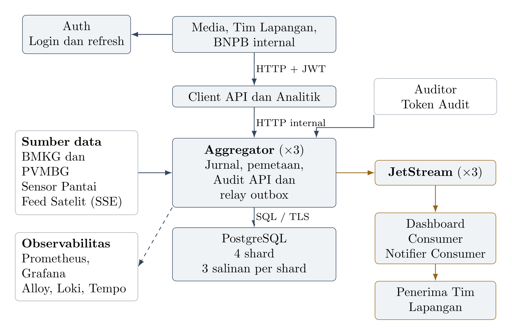
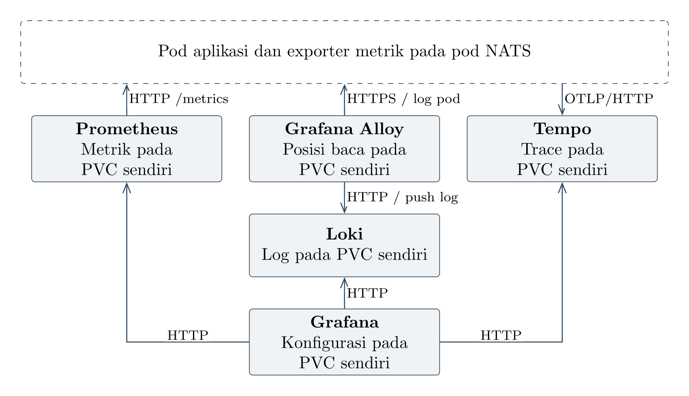

<a id="readme-top"></a>

<div align="center">
  <h3 align="center">IF4031/AAT - Koordinasi Kebencanaan M2</h3>
  <p align="center">
    Tugas Besar IF4031 Arsitektur Aplikasi Terdistribusi<br/>
    Milestone 2 · DikejarDeadline
  </p>
</div>

<div align="center">
  <br/>
  
  
  
  
</div>

---

<details>
  <summary>Daftar Isi</summary>
  <ol>
    <li><a href="#latar-belakang">Latar belakang</a></li>
    <li><a href="#arsitektur">Arsitektur</a></li>
    <li><a href="#menjalankan-aplikasi">Menjalankan aplikasi</a></li>
    <li><a href="#variabel-konfigurasi">Variabel konfigurasi</a></li>
    <li><a href="#pengujian-per-problem">Pengujian per problem</a>
      <ul>
        <li><a href="#problem-1">P1: Yang Pulang Membawa Laptopnya</a></li>
        <li><a href="#problem-2">P2: Dua Nakhoda, Satu Kapal</a></li>
        <li><a href="#problem-3">P3: Surat dari Tetangga</a></li>
        <li><a href="#problem-4">P4: Atap Seng di Siang Bolong</a></li>
        <li><a href="#problem-5">P5: Pelampung yang Berbohong</a></li>
      </ul>
    </li>
    <li><a href="#observabilitas">Observabilitas</a></li>
    <li><a href="#menghentikan-sistem">Menghentikan sistem</a></li>
    <li><a href="#lokasi-kode-dan-laporan">Lokasi kode dan laporan</a></li>
  </ol>
</details>

## Latar belakang

Repositori ini berisi tugas besar IF4031 Arsitektur Aplikasi Terdistribusi tentang koordinasi kebencanaan BNPB. Sistem menggabungkan data dari beberapa sumber menjadi `HazardEvent`, lalu menyajikannya sesuai kebutuhan Media, Tim Lapangan, dan BNPB Internal.

Pada Milestone 1, sistem mengambil data gempa, peringatan tsunami, dan aktivitas gunung api dari mock BMKG dan PVMBG. Milestone 2 menambahkan Feed Satelit untuk deteksi kebakaran, Sensor Pantai untuk pengamatan pesisir, laporan Tim Lapangan, dan Dasbor Analitik. Penyimpanan dibagi ke empat shard PostgreSQL, sedangkan Aggregator dan JetStream direplikasi agar layanan tetap berjalan ketika satu worker gagal.

[Laporan M2](docs/report-m2/IF4031_M2_DikejarDeadline.pdf) · [Pengujian P1–P5](#pengujian-per-problem) · [Panduan M1](README-m1.md)

## Arsitektur



Aggregator menyimpan hasil pengolahan pada PostgreSQL dan menerbitkan perubahan melalui JetStream. Client API melayani pembacaan dan laporan Tim Lapangan. Notifier meneruskan peringatan pesisir kritis ke Penerima Tim Lapangan. Diagram deployment dan batas layanan tersedia di [Bab 2 laporan](docs/report-m2/IF4031_M2_DikejarDeadline.pdf).

### Topologi

Klaster k3s terdiri dari **empat node VM Ubuntu 24.04**, masing-masing dengan kernel dan disk sendiri. `aat-dev` menjalankan control plane, API, Auth, mock, consumer, dan observabilitas. Ketiga worker menjalankan Aggregator dan JetStream. Empat shard PostgreSQL memiliki tiga salinan per shard yang tersebar pada keempat node.

| Node | Peran | Multipass (vCPU / RAM) | Hetzner Helsinki (vCPU / RAM) |
| --- | --- | --- | --- |
| `aat-dev` | Control plane dan worker | 4 / 8 GiB | CCX33 · 8 / 32 GB |
| `aat-worker-1` | Worker | 2 / 3 GiB | CPX32 · 4 / 8 GB |
| `aat-worker-2` | Worker | 2 / 3 GiB | CCX23 · 4 / 16 GB |
| `aat-worker-3` | Worker | 2 / 3 GiB | CPX32 · 4 / 8 GB |
| `aat-loadgen` | VM k6 di luar klaster | Host pengujian terpisah bila diperlukan | CPX52 · 12 / 24 GB |

- **Multipass.** Keempat node berada pada satu laptop pengembangan dengan 12 logical CPU dan RAM 32 GiB. Setiap VM menggunakan disk 30 GiB.
- **Hetzner.** Keempat node berada pada empat host fisik berbeda melalui satu [placement group tipe spread](https://docs.hetzner.com/cloud/placement-groups/overview/). VM load generator berada di jaringan privat yang sama, di luar placement group klaster. CPU/RAM fisik dikelola penyedia, sehingga tabel mencatat alokasi tiap VM.

<div align="right"><a href="#readme-top">↖ Kembali ke atas</a></div>

---

## Menjalankan aplikasi

Pilih **Multipass** untuk menjalankan klaster di mesin lokal, atau **Hetzner** untuk menyiapkan klaster dan load generator terpisah melalui OpenTofu. Langkah pengujian di bawah berlaku untuk kedua profil. Siapkan Git, Bash, Python 3, dan GNU Make pada host.

```bash
git clone https://github.com/ryonlunar/tugas-besar-AAT.git
cd tugas-besar-AAT
git checkout milestone-2
```

### Multipass

Pasang Multipass dan aktifkan virtualisasi pada host. Bila executable berada di luar PATH, set `AAT_MULTIPASS_BIN` ke lokasinya.

```bash
make up
make deploy
"${AAT_MULTIPASS_BIN:-multipass}" shell aat-dev
```

### Hetzner

Siapkan OpenTofu, OpenSSH, dan jq. Simpan token API Hetzner dengan akses Read & Write di `~/.config/aat-hetzner/token` dengan izin `600`. Isi `SSH_CIDR` dengan IPv4 publik mesin yang akan dipakai untuk SSH, diikuti `/32`. Jalankan `up` setelah meninjau plan karena VM yang dibuat berbayar.

```bash
read -rp 'IPv4 publik untuk SSH (dengan /32): ' SSH_CIDR
infra/hetzner/cloud.sh plan m2-demo "$SSH_CIDR" milestone-2
infra/hetzner/cloud.sh up m2-demo
infra/hetzner/cloud.sh ssh m2-demo aat-dev
su - ubuntu
```

Untuk mengakses dasbor dari browser lokal, buka tunnel dari host dan biarkan perintah ini berjalan:

```bash
RUN_DIR=.state/hetzner/m2-demo
CONTROL_PUBLIC_IP=$(jq -er '."aat-dev".public_ipv4' "$RUN_DIR/nodes.json")
ssh -N -i "$RUN_DIR/ssh" -o IdentitiesOnly=yes -o UserKnownHostsFile="$RUN_DIR/known_hosts" \
  -L 30080:10.77.0.11:30080 -L 30000:10.77.0.11:30000 "root@$CONTROL_PUBLIC_IP"
```

Buka `http://localhost:30080/analytics/` dan `http://localhost:30000`.

### Pemeriksaan awal

Setelah masuk ke control plane sebagai `ubuntu`, periksa deployment dan catat alamat yang akan digunakan untuk pengujian.

```bash
cd ~/aat
source scripts/m2/demo-env.sh
make cluster-check
printf 'Client API: %s\nAuth: %s\nGrafana: http://%s:30000\n' "$API_URL" "$AUTH_URL" "$NODE_IP"
```

Dasbor Analitik tersedia di `$API_URL/analytics/`. Token akses dapat diambil dengan `field_login` pada terminal control plane. Buka akses browser melalui tunnel SSH jika klaster berada di jaringan privat.

## Variabel konfigurasi

Daftar lengkap dan nilai bawaan ada di [`.env.example`](.env.example). Pada k3s, `deploy-cluster.sh` membaca pengaturan nonsecret dari `.state/m2/runtime.env` dan menerapkannya sebagai ConfigMap. Secret aplikasi dibuat pada deploy pertama dan berkasnya berada di `.state/m2/credentials.json`.

| Pengaturan | Lokasi atau cara mengisi |
| --- | --- |
| Mock dan batas request | `runtime.env`: `MOCK_EVENT_INTERVAL`, `API_MAX_INFLIGHT`, `AGGREGATOR_MAX_INFLIGHT`, dan pengaturan timeout di `.env.example`. |
| Koordinasi dan replay | `runtime.env`: `SOURCE_SESSION_IDLE_TIMEOUT`, `SOURCE_RETRY_INTERVAL`, `PVMBG_SCHEMA_ADAPTERS`, `INGEST_PROCESSING_ENABLED`, `FIELD_REPORT_PROCESSING_ENABLED`. |
| Katalog BMKG | Salin CSV ke `.state/m2/bmkg-catalog.csv` sebelum deploy yang akan memuat katalog. |
| Audit dan hak akses client | `credentials.json`: `AUDIT_TOKEN` dan secret Auth masing-masing client. Gunakan token Audit dari asisten untuk pengujian resmi. |
| Feed Satelit | `SATELLITE_BASE_URL` di `runtime.env` serta Secret `satellite-secret` dengan key `token`. |
| Sensor Pantai | `PANTAI_BASE_URL` di `runtime.env` serta Secret `pantai-token` dengan key `token`. Profil sumber ada pada manifest Sensor Pantai. |
| Tester Agent | Secret `tester-key` di namespace `tester-agent` untuk skenario ujian. |

Setelah mengubah nilai, jalankan `bash scripts/m2/deploy-cluster.sh` dari control plane. Bila perubahan hanya menyentuh konfigurasi atau Secret yang dibaca sebagai environment, restart deployment terkait agar pod membaca nilai baru. Contoh untuk Aggregator:

```bash
bash scripts/m2/deploy-cluster.sh
k rollout restart deployment/aggregator
k rollout status deployment/aggregator
```

<div align="right"><a href="#readme-top">↖ Kembali ke atas</a></div>

---

## Pengujian per problem

### Terminal pengujian

Jalankan dari direktori aplikasi di control plane. Variabel dan fungsi berikut dipakai pada langkah P1–P5. Gunakan satu direktori hasil per sesi.

```bash
cd ~/aat
source scripts/m2/demo-env.sh
```

Token client berlaku 60 detik. Fungsi `field_login`, `ops_login`, dan `media_login` mengambil token sesuai hak akses. Fungsi `amati` melakukan pembacaan sebagai Tim Lapangan dan menampilkan status HTTP serta `time_total`. Output dapat disimpan di `$EVIDENCE`.

### Tester Agent

Jalankan dari control plane setelah aplikasi terpasang. Target Make menggunakan manifest resmi pada revisi yang ditentukan spesifikasi. Untuk klaster Multipass dari versi sebelumnya, jalankan `make up` dari host agar semua node memakai konfigurasi terbaru. Bila Make belum tersedia di control plane, jalankan `sudo apt-get install -y make`.

```bash
make tester-install
make tester-list
```

Pastikan satu pod Ready pada setiap node, termasuk control plane. Skenario latihan dapat berjalan tanpa key. Buka terminal kedua pada control plane untuk menonton log saat skenario berjalan.

```bash
export KUBECONFIG="$HOME/.kube/aat-dev.yaml"
kubectl -n tester-agent logs -l app=tester-agent --prefix --tail=30 -f
```

Tunggu aksi dan pemulihan akhir tercatat sebelum memulai skenario lain. Simpan log lengkap dengan `make -s tester-logs >"$EVIDENCE/tester-actions.log"`. Pada uji perubahan jam, urutkan aksi berdasarkan `seq` dari pod yang menjalankan skenario.

Untuk ujian, isi Secret `tester-key` sesuai format yang diberikan asisten dan gunakan perintah skenario dari instruksi ujian. Manifest memasang Secret di `/var/run/tester`. Rekam log Agent selama gangguan berlangsung.

<a id="problem-1"></a>

### P1: Yang Pulang Membawa Laptopnya

1. Siapkan CSV acuan pada control plane. Dari terminal kedua, rekam beban sebelum dan selama impor. Deployment mengemas katalog bersama image Aggregator dan melanjutkan dari baris terakhir bila impor terputus.

   ```bash
   while true; do date -u -Is; kubectl top nodes; sleep 5; done
   ```

   ```bash
   cp /path/ke/katalog.csv .state/m2/bmkg-catalog.csv
   bash scripts/m2/deploy-cluster.sh
   ```

   Untuk latihan lonjakan regional, gunakan klaster latihan dan impor sejumlah event dengan ID unik dari satu wilayah. Contoh 500 baris Sumatera Barat:

   ```bash
   {
     printf '%s\n' 'event_id,occurred_at,latitude,longitude,depth_km,magnitude,region_name,potential_tsunami'
     for n in {1..500}; do
       printf 'synthetic-eq-%05d,2023-11-14T22:15:37Z,-0.73,100.23,10.6,4.5,Sumatera Barat,false\n' "$n"
     done
   } > .state/m2/bmkg-catalog.csv
   bash scripts/m2/deploy-cluster.sh
   ```

   Rekam beban tiap node dan bandingkan jumlah record pada empat shard. Gunakan `make foundation-check` untuk mengulang uji penghentian dan pelanjutan impor pada basis data terpisah.
2. Simpan penempatan primary dan replica serta hasil Audit. Untuk memeriksa kursor, panggil halaman pertama dan lanjutkan memakai `meta.next_cursor`. Periksa urutan `occurred_at` dan ID sebagai tie-breaker.

   ```bash
   k get pods -l role=store -o wide -L cluster-name,postgres-role | tee "$EVIDENCE/p1-placement.txt"
   for shard in shard-0 shard-1 shard-2 shard-3; do
     primary=$(k get pod -l "cluster-name=$shard,postgres-role=master" -o jsonpath='{.items[0].metadata.name}')
     printf '%s ' "$shard"
     k exec "$primary" -- psql -U postgres -d aat -Atc 'SELECT count(*) FROM hazard_events;'
   done | tee "$EVIDENCE/p1-shard-counts.txt"
   make pipeline-check | tee "$EVIDENCE/p1-audit.txt"
   curl -fsS -H "Authorization: Bearer $(field_login)" "$API_URL/v1/hazards?view=full&limit=50" >"$EVIDENCE/p1-page1.json"
   cursor=$(jq -er '.meta.next_cursor' "$EVIDENCE/p1-page1.json")
   curl -fsS -G -H "Authorization: Bearer $(field_login)" --data-urlencode "cursor=$cursor" \
     "$API_URL/v1/hazards?view=full&limit=50" >"$EVIDENCE/p1-page2.json"
   ```

3. Buka `k port-forward service/aggregator 18083:8083` dari terminal kedua yang sudah menjalankan `source scripts/m2/demo-env.sh`. Ambil checksum sebelum gangguan dan simpan hasilnya. Pilih cakupan checksum sesuai referensi asisten dan catat perubahan yang masuk dari sumber live selama pengukuran.

   ```bash
   audit 'checksum?source=BMKG' | tee "$EVIDENCE/p1-checksum-before.json"
   ```

4. Pastikan tiap primary memiliki replica pada node lain. Jalankan pembacaan lintas shard dari terminal pengujian, lalu picu gangguan dari terminal lain. Perhatikan status HTTP, waktu, serta `meta.partial` dan `meta.unavailable_units` selama pemulihan.

   ```bash
   while true; do
     date -u -Is
     amati '/v1/hazards?view=full&limit=50'
     sleep 2
   done | tee "$EVIDENCE/p1-recovery-reads.txt"
   ```

   Gunakan `make tester-run SCENARIO=kill-store` untuk latihan penggantian pod. Lakukan latihan kehilangan disk pada klaster yang disiapkan untuk penghapusan data. Jalankan `make tester-run SCENARIO=wipe-node`, lalu catat nama worker yang disebut pada log Agent. Setelah skenario selesai, jalankan ini pada control plane:

   ```bash
   read -rp 'Nama worker yang hilang: ' LOST_WORKER
   case "$LOST_WORKER" in aat-worker-[123]) kubectl delete node "$LOST_WORKER" ;; esac
   ```

   Pada host Multipass, isi nama worker yang sama. Lanjutkan pembacaan selama worker baru bergabung.

   ```bash
   read -rp 'Nama VM worker yang akan diganti: ' LOST_WORKER
   case "$LOST_WORKER" in
     aat-worker-[123]) "${AAT_MULTIPASS_BIN:-multipass}" delete --purge "$LOST_WORKER" &&
       make join-worker NODE="$LOST_WORKER" ;;
   esac
   ```

   Pada host Hetzner, gunakan state OpenTofu dari sesi yang sama. Isi nama worker yang sudah hilang dan tinjau plan. Terapkan hanya jika plan mengganti worker tersebut.

   ```bash
   read -rp 'Nama VM worker yang akan diganti: ' LOST_WORKER
   RUN_DIR=.state/hetzner/m2-demo
   export HCLOUD_TOKEN="$(<"${AAT_HCLOUD_TOKEN_FILE:-$HOME/.config/aat-hetzner/token}")"
   if [[ $LOST_WORKER == aat-worker-[123] ]]; then
     tofu -chdir="$RUN_DIR" plan -replace="hcloud_server.node[\"$LOST_WORKER\"]" -out=worker.tfplan
   fi
   ```

   ```bash
   tofu -chdir="$RUN_DIR" apply worker.tfplan
   tofu -chdir="$RUN_DIR" output -json nodes >"$RUN_DIR/nodes.json"
   NEW_PUBLIC_IP=$(jq -er --arg node "$LOST_WORKER" '.[$node].public_ipv4' "$RUN_DIR/nodes.json")
   ssh-keygen -R "$NEW_PUBLIC_IP" -f "$RUN_DIR/known_hosts"
   infra/hetzner/cloud.sh join-worker m2-demo "$LOST_WORKER"
   unset HCLOUD_TOKEN
   ```

   Kembali ke terminal pengujian pada control plane:

   ```bash
   make tester-install
   for shard in shard-0 shard-1 shard-2 shard-3; do
     k wait "statefulset/$shard" --for='jsonpath={.status.readyReplicas}=3' --timeout=600s
   done
   make cluster-check
   k get pods -l role=store -o wide -L cluster-name,postgres-role
   audit 'checksum?source=BMKG' | tee "$EVIDENCE/p1-checksum-after.json"
   ```

   Buka ulang port-forward Audit bila pod yang dipilih sebelumnya terhenti. Sebelum mengakhiri skenario, pastikan setiap shard kembali memiliki tiga salinan, lalu cocokkan checksum akhir dengan baseline dan referensi resmi pada cakupan data yang sama.
5. Buka `$API_URL/analytics/` pada browser dan gunakan token client. Bandingkan agregat dengan Audit pada rentang waktu UTC yang sama. Catat coverage saat satu unit tidak terjangkau, serta tren kategori, severity, dan wilayah.

<a id="problem-2"></a>

### P2: Dua Nakhoda, Satu Kapal

1. Catat tiga replika Aggregator, endpoint yang melayaninya, dan pemilik sumber dari log upstream.

   ```bash
   k get pods -l app=aggregator -o wide
   k get endpointslice -l kubernetes.io/service-name=aggregator
   for source in bmkg pvmbg; do
     k logs "deployment/$source-mock" --since=2m | jq -c 'select(.status == 200 and .aggregator_instance != "")'
   done
   make tester-run SCENARIO=kill-leader
   ```

   Tunggu aksi muncul pada log Agent, kemudian rekam kondisi setelah gangguan.

   ```bash
   k rollout status deployment/aggregator
   k logs deployment/bmkg-mock --since=2m >"$EVIDENCE/p2-bmkg.log"
   k logs deployment/pvmbg-mock --since=2m >"$EVIDENCE/p2-pvmbg.log"
   make -s tester-logs >"$EVIDENCE/p2-tester.log"
   ```

   Cocokkan pod yang dihentikan dengan `aggregator_instance` pada log sebelum gangguan. Jika Agent memilih replika lain, gunakan `k delete pod "$OWNER_POD"` dengan nama pemilik yang sudah dicatat. Rekam waktu dari polling sukses terakhir pemilik lama ke polling sukses pertama pemilik baru. Targetnya maksimal 60 detik tanpa ID hilang atau berulang.

2. Uji perubahan jam dan freeze secara bergantian. Temukan worker pemilik dari kolom NODE pada `k get pod "$OWNER_POD" -o wide`. Ulangi pemeriksaan upstream dan urutan ID setelah setiap gangguan.

   ```bash
   make tester-run SCENARIO=clock-skew
   make -s tester-logs >"$EVIDENCE/p2-clock.log"
   ```

   Simpan log lengkap setelah Agent mengakhiri skenario. Untuk freeze Multipass, jalankan pada host dengan nama VM pemilik saat itu. Pada penyedia lain, gunakan fitur suspend/resume VM yang tersedia pada host.

   ```bash
   read -rp 'Nama VM pemilik aktif: ' OWNER_NODE
   "${AAT_MULTIPASS_BIN:-multipass}" suspend "$OWNER_NODE"
   sleep 36
   "${AAT_MULTIPASS_BIN:-multipass}" start "$OWNER_NODE"
   ```

   Pada Hetzner, masuk ke worker pemilik dengan `infra/hetzner/cloud.sh ssh m2-demo "$OWNER_NODE"`. Bekukan kedua cgroup, lalu aktifkan kembali. Jalankan pada worker yang bersangkutan, sebagai root.

   ```bash
   systemd-run --on-active=50s /usr/bin/systemctl thaw k3s-agent.service kubepods.slice
   systemctl freeze k3s-agent.service kubepods.slice
   date -u -Is
   sleep 36
   systemctl thaw k3s-agent.service kubepods.slice
   date -u -Is
   ```

   Periksa bahwa pemilik lama melepas sesi lama sebelum menyimpan hasil lagi. `make foundation-check` menyertakan uji `TestExpiredOwnerCannotAppendAfterTakeover` untuk penolakan penulisan stale.

3. Siapkan kembali tiga Aggregator. Pada host load generator, siapkan Linux, Python 3, dan k6. Salin `scripts/load/m2-p2.js` dan `scripts/load/run-m2-p2.py` ke direktori yang sama. Untuk VM `aat-loadgen` pada Hetzner, jalankan dari host repositori:

   ```bash
   for file in m2-p2.js run-m2-p2.py m2-priority.js; do
     infra/hetzner/cloud.sh ssh m2-demo aat-loadgen \
       "umask 077; cat > /root/aat-bench/$file" <"scripts/load/$file"
   done
   infra/hetzner/cloud.sh ssh m2-demo aat-loadgen
   cd /root/aat-bench
   export K6_BIN="$PWD/k6"
   ```

   Gunakan alamat API dan Auth yang dapat dijangkau load generator. Contoh Hetzner adalah `http://10.77.0.11:30080` dan `http://10.77.0.11:30084`. Ambil secret Tim Lapangan dari `credentials.json` pada control plane.

   ```bash
   read -rp 'URL Client API: ' P2_API_URL
   read -rp 'URL Auth: ' P2_AUTH_URL
   export P2_API_URL P2_AUTH_URL
   run_p2() {
     local secret
     read -rsp 'Secret Tim Lapangan: ' secret; printf '\n'
     printf '%s\n' "$secret" | python3 run-m2-p2.py "$1"
   }
   run_p2 p2-scale
   ```

   Pantau `p2-scale/active-vus.jsonl` dari terminal kedua pada mesin k6. Setelah mencapai 10.000 VU, jalankan perubahan berikut pada control plane selama beban bertahan.

   ```bash
   date -u -Is
   k scale deployment/aggregator --replicas=5
   k rollout status deployment/aggregator
   date -u -Is
   k scale deployment/aggregator --replicas=2
   k rollout status deployment/aggregator
   date -u -Is
   ```

   Simpan `active-vus.jsonl`, `result.json`, waktu perubahan, dan bukti satu pemilik per sumber. Targetnya minimal 120 s pada 10.000 VU dan galat tak terduga di bawah 1%, di luar penolakan terkontrol.

4. Untuk throughput, jalankan `k scale deployment/aggregator --replicas=1` dan tunggu rollout. Di mesin k6, jalankan `P2_RATE=1800 P2_SECONDS=35 run_p2 p2-one`. Ubah ke tiga replika, tunggu rollout, lalu jalankan `P2_RATE=1800 P2_SECONDS=35 run_p2 p2-three`. Bandingkan throughput HTTP 200 dan respons lengkap secara terpisah. Catat respons parsial dan 429.
5. Siapkan dua image untuk pengujian pergantian versi. Uji laporan memakai `13c638c` sebagai versi awal. Di control plane, simpan image rilis dan pasang versi awal:

   ```bash
   NEW_AGGREGATOR_IMAGE=$(k get deployment/aggregator -o jsonpath='{.spec.template.spec.containers[?(@.name=="aggregator")].image}')
   OLD_AGGREGATOR_IMAGE=aat.local/aggregator:m2-13c638c
   previous=$(mktemp -d)
   git clone --quiet --no-checkout https://github.com/ryonlunar/tugas-besar-AAT.git "$previous/repo"
   mkdir "$previous/src"
   git -C "$previous/repo" archive 13c638c go.mod go.sum .dockerignore contracts pkg services |
     tar -xf - -C "$previous/src"
   sudo buildah bud --layers --format docker --isolation chroot --network host \
     -t "$OLD_AGGREGATOR_IMAGE" -f "$previous/src/services/aggregator/Dockerfile" "$previous/src"
   sudo buildah push --tls-verify=false "$OLD_AGGREGATOR_IMAGE" docker://aat-control:30500/aggregator:m2-13c638c
   k set image deployment/aggregator aggregator="$OLD_AGGREGATOR_IMAGE"
   k rollout status deployment/aggregator
   ```

   Jalankan workload 10.000 VU dari mesin k6 dengan direktori hasil baru `p2-rollout`. Saat beban stabil, jalankan `k set image deployment/aggregator aggregator="$NEW_AGGREGATOR_IMAGE"` dan `k rollout status deployment/aggregator`. Simpan digest sebelum dan sesudah, waktu pergantian, dan jumlah permintaan gagal. Akhiri uji dengan tiga Aggregator versi rilis.

<a id="problem-3"></a>

### P3: Surat dari Tetangga

1. Buka port-forward PVMBG dari terminal kedua pada control plane.

   ```bash
   source scripts/m2/demo-env.sh
   k port-forward service/pvmbg-mock 18082:8082
   ```

2. Uji satu mode per polling. Bandingkan respons kompatibel versi 2 dengan tiga mode yang diparkir. Simpan daftar sebelum dan sesudah agar pesan dari sesi sebelumnya bisa dikenali.

   ```bash
   pvmbg_mode() {
     curl -fsS -H "Authorization: Bearer $(jq -er '.PVMBG_TOKEN' "$CREDS")" \
       -H 'Content-Type: application/json' -d "$1" http://127.0.0.1:18082/admin/schema-version
   }
   ops_failed() {
     curl -fsS -H "Authorization: Bearer $(ops_login)" "$API_URL/failed-messages?source=PVMBG&limit=1000"
   }
   ops_failed >"$EVIDENCE/p3-before.json"
   pvmbg_mode '{"version":2}'
   amati '/v1/hazards?source=PVMBG&view=full&limit=3'
   pvmbg_mode '{"mode":"rename_field"}'
   sleep 8
   ops_failed | jq '.items[-3:]'
   pvmbg_mode '{"mode":"type_change"}'
   sleep 8
   ops_failed | jq '.items[-3:]'
   pvmbg_mode '{"mode":"missing_required_field"}'
   sleep 8
   ops_failed >"$EVIDENCE/p3-parked.json"
   pvmbg_mode '{"version":1}'
   ```

   Jika entri belum muncul, tunggu polling berikutnya sebelum mengganti mode. Periksa `reason`, `received_at`, dan `retryable`. Untuk satu pesan baru, isi `MESSAGE_ID` dari daftar lalu jalankan:

   ```bash
   read -rp 'ID pesan yang akan diperiksa: ' MESSAGE_ID
   curl -fsS -H "Authorization: Bearer $(ops_login)" "$API_URL/failed-messages/$MESSAGE_ID" |
     tee "$EVIDENCE/p3-message.json" | jq 'del(.payload_base64, .auxiliary_base64)'
   jq -r '.payload_base64' "$EVIDENCE/p3-message.json" | base64 -d >"$EVIDENCE/p3-payload.bin"
   for login_as in media_login field_login; do
     curl -sS -o /dev/null -w 'HTTP %{http_code} time_total=%{time_total}s\n' \
       -H "Authorization: Bearer $("$login_as")" "$API_URL/failed-messages/$MESSAGE_ID"
   done
   ```

   Kedua client terakhir menerima 403. Jalankan `make foundation-check` untuk fixture JSON terpotong, bersarang dalam, UTF-8 tidak valid, masukan berlebih, serta perbedaan antara retry dan park. `make pipeline-recovery` memeriksa pemulihan jurnal pada klaster.

3. Aktifkan adapter dan replay pesan parkir dari sesi ini dalam urutan pada daftar. Untuk lebih dari satu halaman, ambil halaman selanjutnya melalui `next_cursor` sebelum memulai replay.

   ```bash
   k set env deployment/aggregator PVMBG_SCHEMA_ADAPTERS=level_alias,eruption_count_string,ash_height_optional
   k rollout status deployment/aggregator
   jq -r --slurpfile before "$EVIDENCE/p3-before.json" \
     '.items[] | select(.status == "parked") | .message_id |
       select(. as $id | [$before[0].items[].message_id] | index($id) | not)' \
     "$EVIDENCE/p3-parked.json" >"$EVIDENCE/p3-replay-ids.txt"
   while IFS= read -r message_id; do
     curl -fsS -X POST -H "Authorization: Bearer $(ops_login)" \
       "$API_URL/failed-messages/$message_id/replay"
   done <"$EVIDENCE/p3-replay-ids.txt"
   ```

   Setelah antrean selesai diproses, ambil daftar dengan `ops_failed` dan pastikan ID tadi hilang dari daftar gagal. Bandingkan revisi dan urutan `source_ref_id` pada Audit. Jika ID yang sama dikirim ke replay lagi, hasilnya `already_processed`. Pulihkan mode awal dan hapus override adapter dengan `k set env deployment/aggregator PVMBG_SCHEMA_ADAPTERS-`, lalu tunggu rollout.

4. Hentikan pemrosesan laporan di hilir dan kirim laporan sebagai Tim Lapangan. Simpan waktu, HTTP 202, dan ID tanda terima.

   ```bash
   k set env deployment/aggregator FIELD_REPORT_PROCESSING_ENABLED=false
   k rollout status deployment/aggregator
   REPORT_KEY="demo-$(date +%s)"
   send_report() {
     curl -fsS -o "$EVIDENCE/p3-receipt.json" -w 'HTTP %{http_code} time_total=%{time_total}s\n' \
       -H "Authorization: Bearer $(field_login)" -H "Idempotency-Key: $REPORT_KEY" \
       -H 'Content-Type: application/json' --data-binary @contracts/examples/field-report.json \
       "$API_URL/field-reports"
   }
   send_report
   REPORT_ID=$(jq -er '.report_id' "$EVIDENCE/p3-receipt.json")
   k logs -l app=aggregator --prefix --since=2m --max-log-requests=10 | grep -F "$REPORT_ID"
   ```

   Isi nama pod pada baris `field report accepted` lalu ganti pod tersebut. Periksa tanda terima dan ulangi POST. Setelah pemrosesan diaktifkan kembali, tunggu status `processed` dengan `attempts: 1`.

   ```bash
   read -rp 'Pod penerima laporan: ' RECEIVER
   k delete pod "$RECEIVER"
   k rollout status deployment/aggregator
   amati "/field-reports/$REPORT_ID"
   send_report
   test "$(jq -er '.report_id' "$EVIDENCE/p3-receipt.json")" = "$REPORT_ID"
   k set env deployment/aggregator FIELD_REPORT_PROCESSING_ENABLED-
   k rollout status deployment/aggregator
   amati "/field-reports/$REPORT_ID"
   ```

<a id="problem-4"></a>

### P4: Atap Seng di Siang Bolong

1. Aktifkan Feed Satelit dari control plane. Masukkan token kelompok untuk latihan atau token yang diberikan untuk sesi ujian.

   ```bash
   runtime_set SATELLITE_BASE_URL https://satellite.naufarrel.dev
   read -rsp 'Bearer token Feed Satelit: ' SATELLITE_TOKEN; printf '\n'
   (
     umask 077
     mkdir -p .secrets
     printf '%s' "$SATELLITE_TOKEN" |
       k create secret generic satellite-secret --from-file=token=/dev/stdin --dry-run=client -o yaml +       > .secrets/satellite-secret.yaml
   )
   bash scripts/m2/deploy-cluster.sh
   k rollout restart deployment/aggregator
   k rollout status deployment/aggregator
   SATELLITE_TOKEN="$SATELLITE_TOKEN" python3 scripts/m2/probe-satellite.py --session |
     tee "$EVIDENCE/p4-session-before.json"
   unset SATELLITE_TOKEN
   ```

   Untuk ujian, mulai sesi dengan `POST https://satellite.naufarrel.dev/v1/exam/start` memakai Bearer token ujian tepat saat rekaman dimulai. Pada latihan, lanjutkan sesi yang ditunjukkan oleh probe.

2. Rekam beberapa menit pemrosesan live. Buka panel **Satellite feed lag**, **Satellite unfinished batches**, dan **Satellite storage latency · p95** di Grafana. Gunakan interval pengukuran yang sama untuk seluruh panel.

   ```bash
   k logs -l app=aggregator --since=3m --prefix --max-log-requests=10 |
     grep -Ei 'satellite|SATELIT' | tee "$EVIDENCE/p4-aggregator-before.log"
   amati '/v1/hazards?source=SATELIT&view=full&limit=10'
   ```

3. Saat kebakaran sedang dikenali, pilih pod yang memproses SATELIT dari log kepemilikan dan ganti pod tersebut. Simpan log pemilik baru dan perkembangan offset. Untuk insiden jaringan pada klaster latihan, gunakan `make tester-run SCENARIO=partition` pada sesi terpisah dan tunggu pemulihan sebelum melanjutkan.

   ```bash
   read -rp 'Pod pemilik SATELIT saat ini: ' SATELLITE_OWNER
   k delete pod "$SATELLITE_OWNER"
   k rollout status deployment/aggregator
   k logs -l app=aggregator --since=3m --prefix --max-log-requests=10 |
     grep -Ei 'satellite|SATELIT' | tee "$EVIDENCE/p4-aggregator-after.log"
   amati '/v1/hazards?source=SATELIT&view=full&limit=10'
   ```

4. Pada workload 60×, catat waktu lonjakan berakhir dan waktu ketika ketertinggalan offset serta antrean batch kembali nol. Laporkan durasinya terhadap target 60 detik dan catat p95 intake-to-storage. Untuk membandingkan hasil akhir, buka port-forward Audit seperti pada P1. Ambil seluruh halaman dengan cakupan SATELIT dan simpan checksum:

   ```bash
   cursor=
   : >"$EVIDENCE/p4-audit-events.jsonl"
   while :; do
     encoded=$(jq -rn --arg value "$cursor" '$value|@uri')
     page=$(audit "events?source=SATELIT&limit=1000${encoded:+&cursor=$encoded}") || break
     jq -e '.partial == false' <<<"$page" >/dev/null || break
     jq -c '.items[]' <<<"$page" >>"$EVIDENCE/p4-audit-events.jsonl"
     cursor=$(jq -r '.next_cursor // empty' <<<"$page")
     [[ -n $cursor ]] || break
   done
   audit 'checksum?source=SATELIT' | tee "$EVIDENCE/p4-checksum.json"
   ```

   Gunakan hasil lengkap dari jendela yang sama dengan referensi asisten. Bandingkan ID, anggota deteksi, revisi/penarikan, dan jumlah deteksi terlambat. Ulangi pemindaian bila Audit memberi hasil parsial. Untuk input terkendali, `make foundation-check` menguji resume, pengelompokan, pembaruan, dan pemulihan state.

<a id="problem-5"></a>

### P5: Pelampung yang Berbohong

1. Aktifkan Sensor Pantai dari manifest tersemat. Pada latihan, buat token satu kali. Bila sudah ada Secret, gunakan nilai yang sama.

   ```bash
   if ! k get secret pantai-token >/dev/null 2>&1; then
     openssl rand -hex 32 | tr -d '\n' |
       k create secret generic pantai-token --from-file=token=/dev/stdin
   fi
   runtime_set PANTAI_BASE_URL http://sensor-pantai:8080
   bash scripts/m2/deploy-cluster.sh
   k rollout restart deployment/aggregator
   k rollout status deployment/aggregator
   make coastal-check
   ```

   Jika asisten memberikan profil ujian dan berkas key, pasang keduanya sebelum perekaman, sesudah deploy terakhir. Gunakan Secret `pantai-key` dan mount hanya-baca sesuai kontrak sensor.

   ```bash
   k create secret generic pantai-key --from-file=key=/path/ke/key --dry-run=client -o yaml | k apply -f -
   k patch deployment sensor-pantai --type=strategic -p '{
     "spec":{"template":{"spec":{
       "containers":[{"name":"sensor","env":[{"name":"PANTAI_PROFILE","value":"exam"}],
         "volumeMounts":[{"name":"key","mountPath":"/var/run/pantai","readOnly":true}]}],
       "volumes":[{"name":"key","secret":{"secretName":"pantai-key"}}]}}}
   }'
   k rollout status deployment/sensor-pantai
   ```

2. Jalankan latihan outage setelah cache terisi. Selama outage, ukur pembacaan pesisir dan beban BMKG/PVMBG sebelum mengembalikan sensor ke satu replika.

   ```bash
   k scale deployment/sensor-pantai --replicas=0
   k rollout status deployment/sensor-pantai
   for i in {1..5}; do
     amati '/v1/hazards?source=SENSOR_PANTAI&view=full&limit=3'
     sleep 2
   done | tee "$EVIDENCE/p5-coastal-outage.txt"
   API_URL="$API_URL" AUTH_URL="$AUTH_URL" FIELD_TEAM_CLIENT_SECRET="$(jq -er '.FIELD_TEAM_CLIENT_SECRET' "$CREDS")" \
     python3 scripts/load/hazards-monotonic.py --seconds 90 --vus-per-source 30 \
     --output "$EVIDENCE/p5-other-sources.json"
   ```

   Tunjukkan status stale atau tidak tersedia dan waktu responsnya. Pada Grafana Explore, pilih Prometheus dan jalankan `sum by (outcome) (rate(aat_operations_total{operation="source_poll",peer="SENSOR_PANTAI"}[30s]))` untuk melihat laju percobaan polling. Ambil p95 BMKG/PVMBG dari keluaran runner. Pulihkan sensor dan periksa data kembali fresh:

   ```bash
   k scale deployment/sensor-pantai --replicas=1
   k rollout status deployment/sensor-pantai
   amati '/v1/hazards?source=SENSOR_PANTAI&view=full&limit=3'
   ```

3. Untuk uji prioritas, kirim beban Media dan Tim Lapangan bersamaan. Gunakan host k6, salin `scripts/load/m2-priority.js`, lalu masukkan URL Client API dan dua access token baru dari `media_login` dan `field_login`. Ambil token sebelum memulai uji 25 detik.

   ```bash
   read -rp 'URL Client API: ' P5_API_URL
   read -rsp 'Access token Media: ' P5_MEDIA_TOKEN; printf '\n'
   read -rsp 'Access token Tim Lapangan: ' P5_FIELD_TOKEN; printf '\n'
   export P5_API_URL P5_MEDIA_TOKEN P5_FIELD_TOKEN
   "${K6_BIN:-k6}" run --summary-export=p5-priority.json m2-priority.js
   unset P5_MEDIA_TOKEN P5_FIELD_TOKEN
   ```

   Periksa bahwa Media menerima 429 dengan `Retry-After` dan Tim Lapangan tetap mendapat 200. Jika beban belum mencapai batas layanan, ulangi dengan `P5_MEDIA_VUS` yang lebih tinggi pada host uji. Ambil token baru pada setiap pengulangan.

4. Pada game day, mulai skenario yang diberikan asisten dan amati dasbor, trace, serta log Tester Agent selama window pemulihan. Catat waktu dan gejala tanpa intervensi selama window. Sesudahnya, simpan data sensor yang diparkir beserta alasan dan periksa tanda terima kritis terhadap daftar independen.

   ```bash
   curl -fsS -H "Authorization: Bearer $(ops_login)" "$API_URL/failed-messages?source=SENSOR_PANTAI" |
     tee "$EVIDENCE/p5-parked.json"
   make field-alerts-check EXPECTED=/path/ke/expected-critical.json
   cp .state/m2/check-field-alerts.json "$EVIDENCE/p5-critical.json"
   ```

   File pembanding berisi array objek dengan `observation_id` dan `available_at` berformat RFC3339. Gunakan waktu data tersedia pada jam pengujian. Cocokkan jumlah peringatan hilang atau ganda, p95 terhadap batas 5 detik, dan pemakaian anggaran keterlambatan. Catat deteksi, dampak, pemulihan, dan perbaikan dalam post-mortem.

## Observabilitas



1. Buka dasbor Grafana pada port `30000`. Pilih interval uji yang sama untuk latency, error rate, throughput, operasi upstream, serta lag. Gunakan Dasbor Analitik pada `/analytics/` untuk hasil agregasi.
2. Ambil trace lintas layanan dan tampilkan durasi setiap langkah di Grafana Explore dengan data source Tempo.

   ```bash
   make cluster-check
   jq -er '.checks.http_database_trace.trace_id' .state/m2/check-cluster.json
   ```

3. Jalankan `amati '/v1/hazards?view=full&limit=5'` untuk menunjukkan status HTTP, `time_total`, dan correlation ID. Salin ID dari respons ke pencarian Loki atau gunakan `kubectl logs`:

   ```bash
   read -rp 'Correlation ID dari respons: ' CID
   k logs -l app=client-api --since=5m --prefix --max-log-requests=10 | grep -F "$CID"
   k logs -l app=aggregator --since=5m --prefix --max-log-requests=10 | grep -F "$CID"
   ```

   Saat merekam, tampilkan juga `psql` dari P1 dan log Tester Agent saat skenario ujian berjalan. Simpan hasil Audit bersama bukti pengujian.

## Menghentikan sistem

Dari host, jalankan `make stop` untuk menghentikan VM Multipass dan menyimpan disk. Gunakan `make start` untuk melanjutkan. Pada Hetzner, salin hasil dari control plane dan load generator sebelum menghapus VM sesi:

```bash
infra/hetzner/cloud.sh down m2-demo
```

## Lokasi kode dan laporan

| Bagian | Lokasi |
| --- | --- |
| Layanan dan kontrak data | [services/](services/) · [contracts/](contracts/) |
| Deployment | [k3s](infra/k8s/) · [OpenTofu untuk Hetzner](infra/hetzner/) |
| Skenario dan pemeriksaan | [scripts/](scripts/) · [Makefile](Makefile) |
| Laporan dan bukti M2 | [PDF](docs/report-m2/IF4031_M2_DikejarDeadline.pdf) · [Sumber dan bukti](docs/report-m2/) |
| Milestone 1 | [Panduan M1](README-m1.md) · [Laporan M1](docs/report/IF4031_M1_DikejarDeadline.pdf) |
