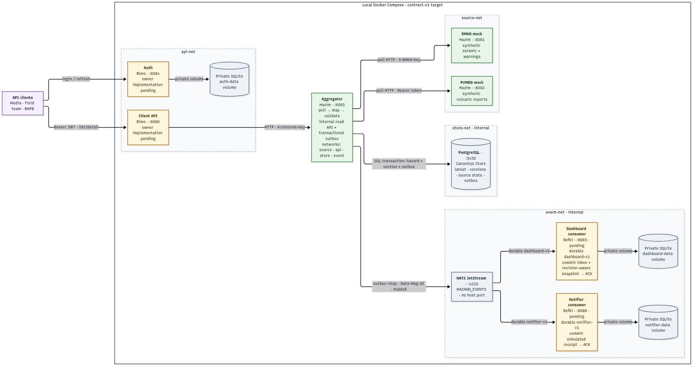

<a id="readme-top"></a>

<div align="center">
  <h3 align="center">IF4031/AAT — Koordinasi Kebencanaan M1</h3>
  <p align="center">
    Ingest dan distribusi event kebencanaan berbasis kontrak M1<br/>
    Go · PostgreSQL · NATS JetStream · Docker Compose
  </p>
</div>

<div align="center">
  <br/>
  
  
  
  
</div>

---

<details>
  <summary>Daftar Isi</summary>
  <ol>
    <li><a href="#status-singkat">Status singkat</a></li>
    <li><a href="#baca-sebelum-coding">Baca sebelum coding</a></li>
    <li><a href="#arsitektur">Arsitektur</a></li>
    <li><a href="#struktur-dan-pembagian">Struktur dan pembagian</a></li>
    <li><a href="#port-default">Port default</a></li>
    <li><a href="#menjalankan-slice-docker-yang-tersedia">Menjalankan slice Docker</a></li>
    <li><a href="#compose-aplikasi-penuh">Compose aplikasi penuh</a></li>
    <li><a href="#konfigurasi">Konfigurasi</a></li>
    <li><a href="#status-dan-batas-implementasi">Status dan batas implementasi</a></li>
  </ol>
</details>

## Status singkat

<a id="status-singkat"></a>

**Status: mock BMKG/PVMBG, mapping, polling, PostgreSQL Canonical Store/riwayat, API internal, transactional outbox dengan guard kapasitas per snapshot, dan publisher JetStream tersedia; slice Docker Compose (dua mock, Aggregator, PostgreSQL, NATS) sudah dibuild dan diuji end-to-end. Auth/Client API, consumer, Compose aplikasi lengkap, load test, dan acceptance P1–P5 masih belum selesai.**

Stack pilihan kelompok: Go, PostgreSQL, NATS JetStream, Docker Compose. Kontrak v1 ditetapkan berdasarkan PDF tugas dan sumber teknis primer; bukan lagi placeholder endpoint/skema.

<div align="right"><a href="#readme-top">↖ Kembali ke atas</a></div>

---

## Baca sebelum coding

<a id="baca-sebelum-coding"></a>

1. [Kontrak implementasi](docs/contract.md): source schema, mapping, endpoint, role, freshness, delivery dan batas service.
2. [Keputusan dan fondasi](docs/decisions.md): D01–D16, masing-masing kebutuhan, alasan, sumber, alternatif/trade-off, dan bukti.
3. [Acceptance matrix](docs/testing-plan.md): kriteria P1–P5 dan pengujian kegagalan.
4. [JSON Schema dan contoh sintetis](contracts/README.md): wire contract lintas-service, bukan shared library business logic.
5. [Hasil verifikasi baseline](docs/verification.md): pemeriksaan nyata dan batas yang belum diuji.

<div align="right"><a href="#readme-top">↖ Kembali ke atas</a></div>

---

## Arsitektur

<a id="arsitektur"></a>



Auth dan Client API terpisah. Consumer memiliki durable dan SQLite sendiri. Hanya Aggregator mengakses PostgreSQL Canonical Store. Consumer tidak memanggil fungsi Aggregator atau membuka databasenya.

<div align="right"><a href="#readme-top">↖ Kembali ke atas</a></div>

---

## Struktur dan pembagian

<a id="struktur-dan-pembagian"></a>

| Lokasi | Pemilik | Fokus |
|---|---|---|
| `services/bmkg-mock/`, `services/pvmbg-mock/`, `services/aggregator/` | Hazim | Source, mapping, polling, PostgreSQL, API internal, outbox, wiring Compose lokal untuk slice ini |
| `services/client-api/`, `services/auth/` | Bimo | Otorisasi, token, API read, bukti load/resilience |
| `services/dashboard-consumer/`, `services/notifier-consumer/` | Refki | Consumer JetStream, Compose aplikasi penuh, network antarservice, deployment/integrasi E2E |
| `contracts/`, `docs/` | Bersama | Wire schema, alasan desain, acceptance/evidence |

Tiap service memiliki entrypoint `cmd/server/`, logic privat `internal/`, serta Dockerfile jika service sudah dimulai implementasinya. Jangan mengimpor business logic service lain. `cmd/` dan `internal/` tingkat root hanya menyimpan catatan kompatibilitas struktur lama; jangan menambahkan logic di sana.

<div align="right"><a href="#readme-top">↖ Kembali ke atas</a></div>

---

## Port default

<a id="port-default"></a>

BMKG **8081**, PVMBG **8082**, Client API **8080** mengikuti spesifikasi. Aggregator 8083, Auth 8084, dashboard consumer 8085, notifier consumer 8086 adalah keputusan proyek. Jika port aplikasi diubah, sesuaikan listener, base URL, dan dokumentasi bersama.

PostgreSQL 5432 dan NATS 4222 hanya di jaringan internal; tidak di-publish ke host. NATS monitoring 8222 tidak di-publish ke host; akses melalui `docker compose exec`. Monitoring tidak membawa mekanisme autentikasi sendiri; jangan expose ke internet.

<div align="right"><a href="#readme-top">↖ Kembali ke atas</a></div>

---

## Menjalankan slice Docker yang tersedia

<a id="menjalankan-slice-docker-yang-tersedia"></a>

Prasyarat: Docker Engine/Desktop dan Compose. Salin konfigurasi contoh hanya jika belum memiliki `.env`, lalu isi lima secret berbeda secara lokal: `BMKG_API_KEY`, `PVMBG_TOKEN`, `AGGREGATOR_API_KEY`, `POSTGRES_PASSWORD`, dan `NATS_TOKEN`.

```bash
cp -n .env.example .env
docker compose config --quiet
docker compose up --build --detach --wait --wait-timeout 180
docker compose ps
```

Saat ini Compose menjalankan dua mock sumber, Aggregator, PostgreSQL, dan NATS. Healthcheck tiap service tersedia. BMKG/PVMBG/Aggregator dipetakan hanya ke loopback host pada port 8081/8082/8083; PostgreSQL dan NATS tidak dipublish. Store/event network tetap internal, sementara source/API network memberi routing yang diperlukan untuk source dan port demo. NATS monitoring hanya diakses dengan `docker compose exec`.

```bash
curl -fsS http://127.0.0.1:8081/health
curl -fsS http://127.0.0.1:8082/health
curl -fsS http://127.0.0.1:8083/ready
docker compose exec -T nats wget -qO- 'http://127.0.0.1:8222/healthz?js-enabled-only=true'
```

Compose mengharuskan secret terisi dan tiap service hanya menerima subset env miliknya—jangan gunakan `env_file` untuk menyuntikkan seluruh `.env`. Aggregator menunggu PostgreSQL saja; poller dan relay mengulang koneksi source/NATS secara independen, sehingga outage keduanya tidak menahan API baca selama Store masih bisa dibaca. `--wait` pada perintah di atas tetap meminta Compose menunggu healthcheck semua service sebagai pemeriksaan operator. Jangan mengunggah `.env`, private key, atau hasil `docker compose config` yang dapat menampilkan nilai rahasia.

Ini baru slice integrasi Hazim. Auth/Client API milik Bimo dan consumer serta Compose lengkap milik Refki belum masuk; karena itu `docker compose up --build` belum mewakili seluruh sistem dan tidak ada klaim acceptance P1–P5 lulus.

<div align="right"><a href="#readme-top">↖ Kembali ke atas</a></div>

---

## Compose aplikasi penuh

<a id="compose-aplikasi-penuh"></a>

Menyiapkan Compose penuh, network antar-container, dan integrasi end-to-end merupakan bagian Refki. Berkas aktif `docker-compose.yml` hanya menjalankan slice lima service Hazim; Auth/Client API dan kedua consumer belum tersedia sebagai image yang bisa dijalankan. Jangan menafsirkan diagram arsitektur sebagai bukti Compose penuh sudah terintegrasi.

<div align="right"><a href="#readme-top">↖ Kembali ke atas</a></div>

---

## Konfigurasi

<a id="konfigurasi"></a>

`.env.example` menetapkan port/base URL, secret per domain, source seed/delay/polling, timeout, pool DB, admission, JWT/refresh, stream/durable/retention, dan outbox retry. Default penting:

- Poll 5 s; timeout BMKG 1 s, PVMBG 4 s; stale threshold 15 s.
- Token TTL 60 s; refresh expiry absolut 24h; private key Auth, public key Client API.
- Stream `HAZARD_EVENTS`, fixed producer subjects `hazard.events.v1.BMKG`/`hazard.events.v1.PVMBG` (bukan override env), `NATS_PUBLISH_TIMEOUT=2s`, durable dashboard-v1/notifier-v1.
- Snapshot polling M1; mutation event + outbox atomik; ACK consumer sesudah side effect commit.

Nilai numeric operasional adalah baseline yang harus dibuktikan lewat load/failure test, bukan angka benchmark yang sudah tercapai. Rincian ada di docs/contract.md.

<div align="right"><a href="#readme-top">↖ Kembali ke atas</a></div>


